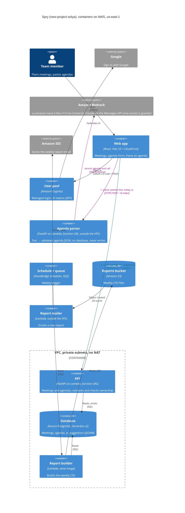

# Container diagram (C4, level 2)

Updated for Lab 6: the agenda parser and Amazon Bedrock. The two Lab 6 paths are drawn in bold:
**parse** (browser → agenda parser → Bedrock) returns JSON and writes nothing; **save** (browser →
API → Aurora) is the same validated path as an agenda typed by hand.

Why the parser is outside the VPC while the API and the report builder are inside: it needs no
database, so it reaches Bedrock over the internet without a NAT gateway or a VPC interface
endpoint ($7.30 a month each), and costs nothing while nobody uses it. See
[ADR 0006](../adr/0006-llm-agenda-parsing.md).
